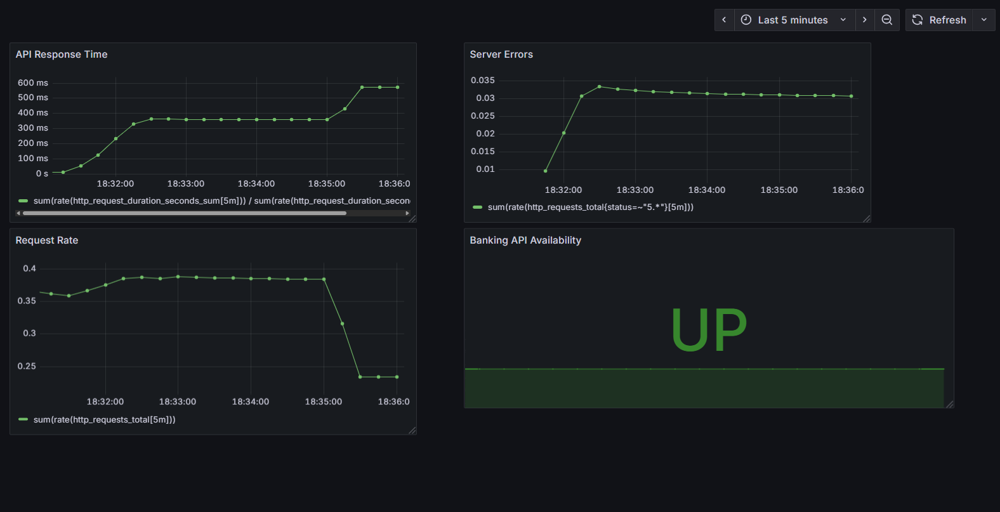

# BankOps Monitor

**A Banking Application Monitoring & Incident Response Lab**

BankOps Monitor is a personal hands-on project designed to simulate application-support activities in a banking environment.

The project demonstrates the deployment, monitoring, troubleshooting, and recovery of a fictional banking transaction API.

## Technologies

- Python and FastAPI — Banking REST API
- PostgreSQL — Transaction database
- Docker Compose — Container orchestration
- Prometheus — Application metrics collection
- Grafana — Monitoring dashboards
- Python scripting — Automated health checks
- Bash scripting — Service diagnostics and log inspection

## Key Features

- REST API for fictional banking transactions
- Database connectivity health checks
- API availability and performance monitoring
- Grafana dashboard for request rates, server errors, and response times
- Automated health checks with timestamped logs
- Bash-based service diagnostics
- Simulated database outage and recovery
- Incident documentation

## Incident Response Exercise

The project includes a simulated PostgreSQL outage.

During testing, the Python monitor detected HTTP 503 responses and subsequently verified recovery with HTTP 200 responses.

The investigation and recovery process is documented in [INC-1](incidents/incident_report1.md) and [INC-2](incidents/incident_report2.md).

## Monitoring Dashboard

## Purpose

This project was created to develop practical experience in IT application support, performance monitoring, troubleshooting, automation, and incident management.

All banking accounts and transactions are fictional and used exclusively for learning.